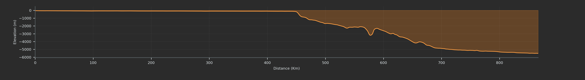
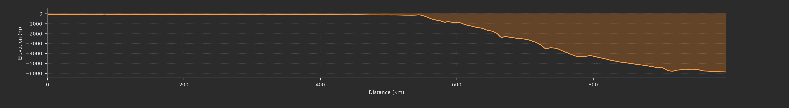
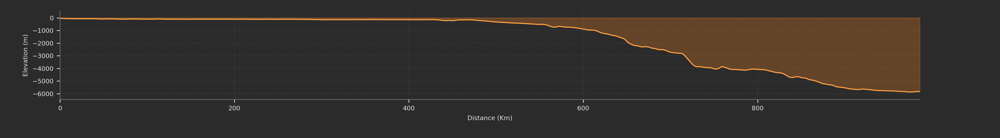

# Mapa geomorfológico del margen continental patagónico (44°–47° S)

**Autor:** Emilio Aliaga  
**Fecha de elaboración:** noviembre de 2026  
**Software:** QGIS 3.44.6
**Documentación:** transcripción y complemento de `Práctica QGIS(2).docx`, contrastados con los archivos del proyecto QGIS entregado.

> **Consideraciones:** El trabajo presenta la interpretación geomorfológica de un sector del margen continental patagónico, dentro de un recorte regional GEBCO 2026 más amplio. **Los porcentajes de procedencia batimétrica (TID) y mapas derivados se calcularon para el recorte completo**, mientras que el mapeo geomorfológico se concentró en el sector 44°–47° S. Se documentan ambas extensiones para evitar confundir sus superficies.

## 1. Fuentes de datos

| Producto | Versión / formato | Fuente y descarga |
| --- | --- | --- |
| Modelo digital de elevación/batimetría | GEBCO_2026 Grid; GeoTIFF, grilla nominal de 15 segundos de arco | [GEBCO_2026 Grid — documentación oficial](https://www.gebco.net/data-products-gridded-bathymetry-data/gebco2026-grid) · [Descarga de recortes](https://betadownload.gebco.net/) |
| Identificador del origen de datos | GEBCO_2026 Type Identifier Grid (TID); GeoTIFF | [Definiciones oficiales de códigos TID](https://www.gebco.net/data-products-gridded-bathymetry-data/gebco2026-grid) |

**Referencia del conjunto:** GEBCO Bathymetric Compilation Group 2026 (2026). *The GEBCO_2026 Grid – a continuous terrain model for oceans and land at 15 arc-second intervals*. [DOI: 10.5285/4f68d5c7-45eb-f999-e063-7086abc036fa](https://doi.org/10.5285/4f68d5c7-45eb-f999-e063-7086abc036fa).

## 2. Área de estudio

### 2.1. Recorte GEBCO 2026

| Norte | Sur | Este | Oeste |
| --- | --- | --- | --- |
| -43.067 | -49.938 | -54.538 | -68.275 |

**Justificación de la elección: ¿qué geoformas esperás encontrar y por qué?**

Como se sugirió incluir costas y el sector más profundo del ambiente marino el mapa abarca una zona geográfica muy amplia, engloba ambientes costeros, plataforma interna, externa, talud, emersión y planicie abisal, por lo tanto las geoformas potenciales son muchas.

Sin embargo, la calidad del dato no es la misma en todo el GeoTIFF, y de hecho al observar el TID toda la zona de plataforma se basa en datos gravimétricos (código 40 del TID) que tiene resoluciones kilométricas, y si bien las zonas costeras marcan una codificación TID 16 (datos satelitales ópticos), que tienen resoluciones métricas a decamétricas dependiendo del satélite, la resolución final depende del DEM: Lo que me lleva al siguiente punto, el DEM de GEBCO tiene una resolución de pixel de 15 segundos de arco, que equivale a ~ 320 × 463 m, una playa o una espiga de barrera, suelen tener un ancho de unos cientos de metros, por lo que no es posible resolver rasgos de ese orden de manera confiable. Si es posible ver claramente, cabos, bahías, sistemas fluviales, etc. Y en el ambiente marino profundo cañones submarinos, terrazas y depósitos contorníticos importantes, y por supuesto cualquier rasgo de mayor escala.

Finalmente destacar que interpretar datos geofísicos es muy diferente a utilizar imágenes satelitales que muestran colores y texturas reales.

### 2.2. Extensión aproximada del recorte GEBCO

Tamaño aproximado del área en km: Una aproximación a este dato es restar las latitudes Norte-Sur y calcular su extensión utilizando una aproximación a metros (un grado ~ 111.2 m) y luego repetir lo mismo con las longitudes considerando la convergencia de los meridianos -> Longitud N-S ~ 764km; Longitud E-O ~ 1051 km  ~ 803.000 km². También se puede usar la herramienta medir área de QGIS.

### 2.3. Extensión sector seleccionado para el mapeo geomorfológico

l sector elegido para digitalizar tiene límites **44.0378°–46.9648° S** y **61.3350°–55.4507° O**. Su superficie cartográfica aproximada es de **149,911 km²** en UTM 20S. Es una zona **distinta del recorte GEBCO completo**, que se utiliza para los porcentajes TID siguientes.

## 3. Metadatos, resolución y referencia vertical

| Parámetro | Batimetría | TID |
| --- | --- | --- |
| CRS (sistema de referencia horizontal) | WGS84 - EPSG:4326 | Igual |
| Datum vertical | Mean sea level* | N/A |
| Tamaño en píxeles | 3297 x 1649 píxeles | Igual |
| Tamaño de celda (grados y metros aproximados**) | 15 segundos de arco / latitud: ~463m: longitud:~320m | Igual |
| Valor mínimo y máximo | Mínimo: -5987; máximo: 961 | Mínimo: 0; máximo: 44 |
| Valor NoData | -32767 | 127 |
| Convención de signos (¿la profundidad es negativa?) | Si, ya que mean sea level es el cero de coordenadas. | N/A |

\*GEBCO informa que algunas fuentes de aguas someras pueden utilizar otros dátums verticales.

\*\*Para la resolución en metros se tomó como valor aproximado 111.2m por cada grado de latitud. Con respecto a la longitud se debe incluir una corrección ya que los meridianos convergen en los polos. Se consideró como aproximación la latitud central del mapa, siendo 46.5°. La cuenta utilizada fue:

NOTA: La exactitud horizontal y vertical es variable y no dependen sólo de estos valores de resolución mostrados en el GeoTIFF- El TID ayuda a realizar una apreciación cualitativa inicial al saber la naturaleza del dispositivo de adquisición usados en cada zona. Pero cuantificar el grado de incertidumbre es mucho más complejo ya que no sabemos nada sobre potenciales errores/limitaciones durante la adquisición de los datos y posterior filtrado y procesamiento, en última instancia si uno no fue parte del proceso de generación del DEM hay que consultar o confiar en la calidad del dato.

### 3.1. Resolución después de reproyectar

| Parámetro | DEM reproyectado |
| --- | --- |
| SRC | WGS 84 / UTM zona 20S (EPSG:32720) |
| Resolución de píxel | 352,584476 × 352,584476 m |
| Dimensiones | 3173 columnas × 2263 filas |
| Unidad horizontal | metros |
| Unidad vertical | metros de elevación respecto del nivel medio del mar asumido por GEBCO |

**Convención de signos:** las elevaciones submarinas se representan con valores negativos; la topografía emergida con valores positivos, usando 0 m como referencia de nivel del mar. El TID es categórico y no expresa profundidades.

## 4. Reproyección y justificación cartográfica (apartado 6 del TP)

6) 1. Entendiendo que no existe una proyección plana que conserve al mismo tiempo distancias, ángulos y superficies sin deformación. Se sacrifica algún aspecto dependiendo de los objetivos y zona a relevar.

Los 1051 km de extensión E-O del DEM que van desde las longitudes 68°O hasta 54° O atraviesan tres zonas UTM (19S, 20S y 21S). UTM está diseñada para minimizar deformaciones dentro de cada faja de 6° de longitud. Fuera de esa franja la deformación se incrementa progresivamente a medida que me alejo del meridiano de referencia. Si yo utilizo por ejemplo la faja 20S, la misma tiene como meridiano central los 63°O, hacia el oeste tengo 5° de longitud, mientras que hacia el este 9°. La deformación va a ser asimétrica y más marcada hacia el este.

Para los alcances de este trabajo es perfectamente aceptable utilizar UTM 20S, ya que las deformaciones resultantes son pequeñas. Sin embargo, si quisiera reducirlas y distribuirlas más equitativamente en todo el DEM, podría usar una proyección Lambert cónica conforme, donde la deformación depende de la latitud y no de la longitud, por lo que no se incrementa hacia los laterales como si pasa en UTM. Además, se puede definir manualmente los paralelos estándar, lo que me permite mantener deformaciones reducidas en toda la zona si los elegís bien.


## 5. Curvas de nivel y pendientes (apartado 8 del TP)

8) 1. Para las isóbatas se seleccionaron intervalos variables de acuerdo con la profundidad y pendiente general. En la plataforma continental (0 a −200 m) se utilizó un intervalo de 50 m, mientras que en los sectores de mayor profundidad se adoptaron intervalos de 200 m (−200 a −2000 m) y 500 m (por debajo de −2000 m). Esta elección busca el equilibrio entre nivel de detalle y legibilidad, evitando una concentración excesiva de curvas en los sectores de mayor pendiente.

**Aclaración:** No se generó un mapa de isobatas mixto con diferente intervalo según la pendiente regional por falta de tiempo.

## 6. Análisis del TID (apartado 9 del TP)

9) 3. El análisis del TID indica que la mayor parte del área (~ 68 %) se encuentra representada mediante batimetría interpolada en base a datos gravimétricos satelitales (código 40). En consecuencia, la confiabilidad de la interpretación geomorfológica será heterogénea. En estas zonas, las unidades fisiográficas regionales como plataforma, quiebre de talud, terrazas, emersión y llanura abisal serán fácilmente reconocibles y con buena confiabilidad.

En cambio, la identificación y delimitación de geoformas de dimensiones menores, como pequeños canales erosivos, cárcavas/gullies y ondas sedimentarias, estará limitada por la resolución efectiva de los datos originales.

Se espera una mayor confianza en la interpretación de cañones submarinos y otros rasgos del talud cuando coincidan con sectores respaldados por datos multihaz (código 11) o monohaz (código 10). Pero como ya se mencionó, la procedencia del dato no alcanza para cuantificar el grado de incertidumbre. Y por otro lado, si bien los relevamientos multihaz alcanzan fácilmente resoluciones decimétricas, GEBCO limitó la resolución a unos 400m por celda.

### 6.1. Códigos TID presentes

**Aclaración:** Se transcriben los porcentajes del archivo **`derivados/resumen_TID_%.gpkg`**. Los porcentajes se refieren a **todas las celdas del recorte GEBCO, incluyendo tierra emergida (TID 0)**.

| Código | Procedencia del dato | Clasificación | % del recorte completo |
| ---: | --- | --- | ---: |
| 0 | Tierra emergida | Sin batimetría marina | 13,31 % |
| 10 | Ecosonda monohaz | Medición directa | 0,45 % |
| 11 | Ecosonda multihaz | Medición directa | 12,63 % |
| 16 | Sensor óptico | Medición directa | 0,31 % |
| 17 | Combinación de métodos directos | Medición directa | 4,58 % |
| 40 | Batimetría predicha/interpolada guiada por gravedad satelital | Indirecta / derivada | **67,84 %** |
| 44 | Grilla de fuentes múltiples medidas y derivadas, interpolación guiada por gravedad | Mixta | 0,89 % |

*La suma de los porcentajes publicados puede diferir de 100 % en 0,01 puntos por redondeo.* El informe original (`derivados/resumen_TID.gpkg`) incluye el recuento de celdas y el área plana por categoría, en m². El área total contabilizada es aproximadamente **806.404 km²** de celdas válidas en la grilla proyectada.

**Distribución espacial en el recorte GEBCO (comprobación cruzada del TID y DEM):** en la plataforma somera de 0 a −200 m, alrededor del **91,25 %** de las celdas corresponde al TID 40; los datos ópticos (16) se concentran en aguas someras y zonas costeras. Los registros multihaz (11) se hacen proporcionalmente más frecuentes en sectores del talud y fondos profundos, donde hay franjas de relevamientos y muchas líneas que corresponden a derrotas. En profundidades mayores que −2000 m, aproximadamente el **38,84 %** de las celdas de esa franja es TID 11 y el **58,80 %** es TID 40.

**Un dato de relevancia** es que el código 40 corresponde a una predicción batimétrica indirecta e interpolada basada en datos gravimétricos satelitales; no equivale a una medición acústica directa ni implica una resolución real  de 15 segundos de arco. El TID permite identificar la fuente, pero no cuantifica directamente la incertidumbre del DEM.

## 7. Digitalización y clasificación geomorfológica (apartado 10 del TP)

### 7.1. Unidad mínima cartografiable (apartado 10.2)

10) 2. El DEM reproyectado a UTM 20S, quedó con una resolución de ~ 353m por celda, se requiere que las geoformas tengan escala kilométrica para poder resolverlas con menor incertidumbre y siempre en sectores donde el TID muestra que los datos provienen de sondeos multihaz o monohaz. Para sectores que derivan de datos gravimétricos satelitales, particularmente aquellos de mucha profundidad (las anomalías gravimétricas se atenúan exponencialmente con la distancia, y afecta mucho más a las de pequeña longitud de onda), intentaría reconocer rasgos de decenas de kilómetros.

### 7.2. Esquema de clasificación

Las morfologías se transcriben de la leyenda del mapa final, provienen del campo `unidad` de `vectores/Geomorfologia.gpkg`. También se usó `vectores/cañones_medianos.gpkg`, una capa de **líneas** que identifica cañones de menor dimensión.

- Plataforma continental externa
- Talud superior
- Sistema de cañones submarinos de gran tamaño
- Sistema de cañones submarinos medianos
- Nivel aterrazado - Talud medio
- Nivel aterrazado - Talud inferior
- Nivel aterrazado - Talud inferior - transición emersión
- Emersión - Transición planicie abisal

### 7.2.1. Criterios por unidad registrados en el GeoPackage

**Complemento para el README:** en la tabla siguiente se documentan literalmente los atributos de la capa `unidades_geomorfologicas` (14 entidades). Se agrupan las seis geometrías de cañones con iguales atributos; se señalan explícitamente los textos incompletos y los campos nulos, sin inventar contenidos.

| Unidad (`unidad`) | Criterio registrado (`criterio`) | Confianza registrada (`confianza`) |
| --- | --- | --- |
| Plataforma continental externa | Sector amplio de muy baja pendiente, mostrando un quiebre relativamente neto en el sector profundo. | Alta |
| Talud superior | Geomorfológico: Sector con un quiebre inferior de pendiente que lo separa del nivel aterrazado inferior. | Media-Baja |
| Sistema de cañones submarinos de gran tamaño (6 polígonos) | Incisiones profundas, isóbatas muy próximas y contrastes pronunciados en el mapa de sombras. Delimitación basada en la continuidad de los valles y sus márgenes. | Media-Alta |
| Nivel aterrazado - Talud medio | Delimitación basada en la continuidad de las pendientes y en la identificación de un quiebre morfológico marcado, reconocido mediante el mapa de pendientes y la disposición de las isóbatas, que señala el inicio del siguiente nivel de aterrazamiento. | Media |
| Nivel aterrazado - Talud inferior | Superficie relativamente extensa caracterizada por pendientes suaves a moderadas y cierta continuidad lateral, delimitada por cambios de gradiente que la separan de los sectores más inclinados del talud y del siguiente nivel aterrazado. | Media |
| Nivel aterrazado - Talud inferior- transición emersión | Sector de mayores pendientes relativas, delimitado por un quiebre morfológico que marca el límite del nivel aterrazado inferior y el comienzo de una disminución progresiva del gradiente hacia la emersión continental. | Media-Baja |
| Emersión-Transición planicie abisal | El sector muestra progresivamente menores pendientes, el sector proximal podría ser aún parte de la emersión, por lo que el límite con la planicie abisal es transicional. | Media-baja |

Capa lineal complementaria `cañones_medianos.gpkg` contiene **15 líneas** que identifican `Cañon mediano`. El criterio es: `Valles más angostos, menos incisos` y confianza `Mediana-alta`.

### 7.3. Perfiles batimétricos (apartado 10.3)

| Perfil* | Profundidad de quiebre (m) | Distancia de la costa (km) | Observaciones |
| --- | --- | --- | --- |
| P1 | 179 | 448 | Cambio abrupto de pendiente, quiebre relativamente neto. |
| P2 | 197 | 547 | Cambio menos abrupto que P1, igualmente reconocible. |
| P3 | 189 | 473 | Pendiente mucho más suave que los otros perfiles, quiebre más transicional. |

*Ver transectas en QGIS. Perfiles guardados en la carpeta salidas.

## 8. Contraste de límites con el TID (apartado 11.3)

Contraste del mapa geomorfológico con el TID

| Límite entre unidades | Criterio de delimitación | TID<br>11: Multihaz; <br>10: Monohaz;<br>40: Gravimetría. | Confianza |
| --- | --- | --- | --- |
| Plataforma externa / talud superior | Quiebre de plataforma; incremento sostenido de pendiente | 40 | Alta-Media |
| Talud superior / talud medio | Disminución del gradiente y comienzo del aterrazamiento | 40 | Media |
| Sistemas de cañones / talud adyacente | Incisiones, cambios de curvatura e inflexiones de isóbatas | Gran parte datos 10, combinados con 11 y completados con 40. | Alta-Media |
| Talud medio / talud inferior | Quiebre de pendiente asociado a otro nivel aterrazado | Por comprobar | Alta-Media |
| Talud inferior / transición a emersión | Cambio de gradiente y de morfología del fondo | Por comprobar | Media-Baja |
| Emersión / planicie abisal | Disminución regional de pendiente y relieve más uniforme | Por comprobar | Baja |

### 8.1. Criterios de confianza

| Nivel | Criterio orientativo |
| --- | --- |
| Alta | Límite geomorfológico nítido, coherente entre pendientes, isóbatas y perfiles, mayormente respaldado por mediciones directas (multihaz o monohaz). |
| Media | Límite reconocible, pero con transición gradual, procedencia mixta de fuentes o predominio parcial de datos indirectos. |
| Baja | Límite poco definido, interpretado principalmente sobre datos gravimétricos con resolución insuficiente |

## 9. Contraste bibliográfico y limitaciones (apartado 11.4)

Se contrastaron las unidades geomorfológicas mapeadas con la grilla TID con el propósito de evaluar la procedencia de los datos batimétricos involucrados en cada sector. Se prestó especial atención a los sectores respaldados por mediciones directas contra aquellos basados en información interpolada mediante gravimetría.

La evaluación de confianza se fundamentó en: la procedencia de los datos batimétricos y la nitidez de los límites morfológicos identificados mediante el DEM, el mapa de pendientes, las isóbatas y los perfiles topográficos.

Como referencia bibliográfica se utilizó el mapa morfosedimentario del margen continental argentino presentado por Hernández-Molina et al. (2010), El mismo interpreta una variedad mucho más amplia de geoformas como sistemas contorníticos, fosas contorníticas, depósitos turbidíticos y una clasificación de sistemas de terrazas y cañones mucho más preciso. La realidad es que puedo arriesgarme a reconocer varias geoformas más, sin embargo, sería útil contar con otros tipos de datos geofísicos complementarios como un mapa de retro-dispersión acústica relevado por un sonar de barriodo lateral, ya que me permite inferir propiedades del tipo de sustrato, muy útil para relevar fondo rocoso vs depósitos seedimentarios (si bien son técnicamente facies acústicas). También es importante contar con sísmica de subfondo, de hecho considero que interpretar un mapa batimétrico sin sísmica de alta resolución de las capas superficiales deja lugar a demasiada especulación.

Finalmente la incorporación de batimetría de mayor resolución permitiría mejorar especialmente la delimitación de cañones submarinos, escarpas y reconocer geoformas de menor escala como remoción en masa, megaóndulas sobre depósitos contorníticos, etc.

## 10. Estructura del repositorio y reproducción

**Complemento para el README (estructura comprobada en el archivo de proyecto):**

```text
proyecto_QGIS/
├── README.md
├── proyecto_QGIS.qgz
├── datos_originales/
│   ├── gebco_2026_n-43.068_s-49.939_w-68.277_e-54.536_geotiff.tif
│   └── gebco_2026_tid_n-43.068_s-49.939_w-68.277_e-54.536_geotiff.tif
├── derivados/
│   ├── GEBCO Repreoyectada UTM 20S EPSG_32720.tif
│   ├── GEBCO_2026_DEM_Repreoyectado_UTM_20S_EPSG_32720 Slopes.tif
│   ├── GEBCO_2026_TID_Repreoyectado_UTM_20S_EPSG_32720.tif
│   ├── resumen_TID.gpkg
│   ├── resumen_TID_%.gpkg
│   └── resumen_TID.html
├── vectores/
│   ├── Geomorfologia.gpkg
│   ├── cañones_medianos.gpkg
│   ├── perfiles_batimetricos.gpkg
│   ├── isobatas_50m.gpkg
│   ├── isobatas_200m.gpkg
│   └── isobatas_500m.gpkg
└── salidas/
    ├── Mapa práctica QGIS.png
    ├── P1.png
    ├── P2.png
    └── P3.png
```

### Salidas - gráficos


**Mapa final:** [PNG de la composición de impresión](salidas/Mapa%20pr%C3%A1ctica%20QGIS.png). Se verificó un tamaño de **4133 × 2480 píxeles**, con metadatos próximos a **300 ppp**.

| Perfil P1 | Perfil P2 | Perfil P3 |
| --- | --- | --- |
|  |  |  |

### Recomendaciones para publicación

No cambiar las rutas ni los nombres de archivo sin actualizar los vínculos del proyecto. En caso de excluir un raster pesado del repositorio, indicar con claridad qué archivo falta, el enlace de descarga y cómo reconstruirlo. El raster de pendientes supera **25 MiB**, límite habitual de carga individual mediante el navegador web de GitHub; puede subirse mediante Git (respetando los límites de GitHub), utilizar compresión GeoTIFF sin pérdida o documentar su regeneración. No se ha publicado todavía el repositorio desde este README.


## 11. Referencias

- GEBCO Bathymetric Compilation Group 2026 (2026). *The GEBCO_2026 Grid – a continuous terrain model for oceans and land at 15 arc-second intervals*. [https://doi.org/10.5285/4f68d5c7-45eb-f999-e063-7086abc036fa](https://doi.org/10.5285/4f68d5c7-45eb-f999-e063-7086abc036fa).
- GEBCO. [Información técnica y clasificación del Type Identifier Grid (TID)](https://www.gebco.net/data-products-gridded-bathymetry-data/gebco2026-grid).
- Hernández-Molina, F. J., et al. (2010). *Giant mounded drifts in the Argentine Continental Margin: Origins, and global implications for the history of thermohaline circulation*. *Marine and Petroleum Geology*, 27(7), 1508–1530, fig. 3. [Artículo completo (PDF)](https://epic.awi.de/22444/1/Her2010b.pdf) · [DOI: 10.1016/j.marpetgeo.2010.04.003](https://doi.org/10.1016/j.marpetgeo.2010.04.003).
